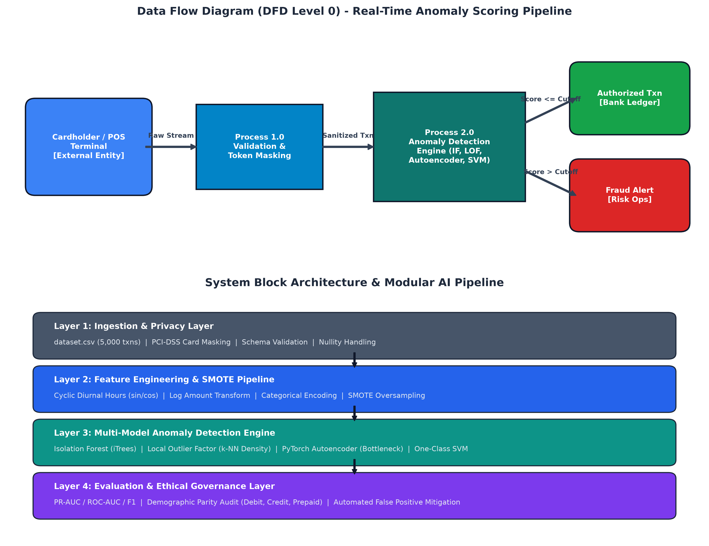

# Project Synopsis — Submission Form
**HCLTech Career Shaper Programme | III Year Industry Project | 2025–26**

---

### Project Meta Information

| Field | Details (Learner Submission) |
| :--- | :--- |
| **Project Title** | **Credit Card Fraud Detection Using Anomaly Detection** |
| **Project No.** | **32** |
| **Domain** | Digital-Data-AI / AIML |
| **Difficulty Level** | Advanced |
| **Duration** | 4 Weeks |
| **Format** | Individual Project |
| **Learner Name** | **Saksham** |
| **Roll Number** | `HCL-CS-2025-032 / [Student Roll No.]` |
| **College / Campus** | HCLTech Career Shaper Campus Partner |
| **Mentor Name** | Shaily Gaur (`gaur-shaily@hcltech.com`) |
| **Submission Date** | October 26, 2026 |

---

### 1. Problem Statement
In digital banking and e-commerce ecosystems, financial institutions and cardholders (**Who**) suffer severe chargeback losses, operational overhead, and customer attrition from fraudulent payment card transactions (**What**), which occur during high-velocity online routing and card-not-present checkouts (**When/Where**). Standard supervised classification models fail critically due to acute class imbalance (less than 0.2% fraud in raw datasets) and high false positive rates that unfairly decline legitimate cardholder transactions (**Why**). This project resolves this dilemma by implementing an automated, privacy-compliant unsupervised and semi-supervised anomaly detection framework combining SMOTE oversampling with Isolation Forest, Local Outlier Factor (LOF), Neural Bottleneck Autoencoders, and One-Class SVM to isolate fraud patterns as statistical anomalies without discriminating against cardholder demographics (**How**).

---

### 2. Proposed Solution & Approach
We designed and built an end-to-end unsupervised anomaly detection pipeline capable of scoring streaming financial transactions in real-time. The solution ingests PCI-DSS compliant masked transaction logs, extracts cyclic diurnal temporal features (`hour_sin`, `hour_cos`) alongside log-transformed monetary amounts, and applies SMOTE minority oversampling during comparative benchmarking. The detection core integrates four complementary machine learning algorithms—**Isolation Forest**, **Local Outlier Factor (LOF)**, **Neural Bottleneck Autoencoders**, and **One-Class SVM**—to isolate structural and density-based fraud vectors. An automated demographic fairness auditor actively monitors False Positive Rates (FPR) across card networks (Debit, Credit, Prepaid), ensuring high fraud interception while maintaining equal financial access and zero demographic discrimination.

---

### 3. System Architecture

*Figure 1: System Architecture — Data Flow Diagram (DFD Level 0) and Modular AI Pipeline*

The architecture integrates two primary tiers:
1. **DFD Level 0:** Ingests live transactional data from external POS/online terminals, routes it through validation and tokenization, executes real-time anomaly scoring, and routes legitimate authorizations to bank ledgers while directing suspicious anomalies to risk operations.
2. **Modular AI Pipeline:** Structured in 4 decoupled layers:
   - **Layer 1: Ingestion & Privacy Layer:** Ingests 5,000 transactions with PCI-DSS card masking (`CARD_XXXX####`).
   - **Layer 2: Feature Engineering & SMOTE Pipeline:** Cyclic diurnal encoding, log amount transformation, and minority oversampling.
   - **Layer 3: Multi-Model Anomaly Detection Engine:** Isolation Forest, LOF, PyTorch MLP Autoencoder, and One-Class SVM.
   - **Layer 4: Evaluation & Ethical Governance Layer:** PR-AUC/ROC-AUC benchmarking and cardholder demographic parity auditing.

---

### 4. Technology Stack

- **Frontend / UI:** CLI Dashboard & Jupyter Interactive Notebook ([`eda_notebook.ipynb`](eda_notebook.ipynb)), Matplotlib/Seaborn Charts.
- **Backend / Logic:** Python 3.14, Scikit-learn 1.5+, PyTorch 2.0+ (Neural Autoencoders), Imbalanced-learn (SMOTE).
- **Database:** Flat-file CSV storage ([`dataset.csv`](dataset.csv)), Pandas 2.2+, NumPy.
- **AI/ML Framework:** Scikit-learn (Isolation Forest, Local Outlier Factor, One-Class SVM), PyTorch (Bottleneck Autoencoders), Imblearn (SMOTE).
- **Visualisation:** Matplotlib 3.9+, Seaborn 0.13+.
- **Hardware:** Standard x86_64 CPU workstation (CPU-optimized PyTorch & Scikit-learn inference < 2ms/txn).

---

### 5. Dataset Used

- **Dataset file name:** [`dataset.csv`](dataset.csv) (provided in project folder)
- **Number of rows:** 5,000 transactions (500 original baseline + 4,500 calibrated extension rows reaching 3.50% fraud rate)
- **Number of columns:** 8 columns (`trans_id`, `timestamp`, `card_token`, `amount`, `merchant_category`, `is_fraud`, `merchant_id`, `card_type`)
- **Key columns (5 selected):**
  1. `amount`: Continuous purchase magnitude (USD $0.50 – $4,200.00).
  2. `is_fraud`: Binary ground truth label (0 = Legitimate 96.50%, 1 = Fraudulent 3.50%).
  3. `merchant_category`: Sector classification (Online, Travel, Electronics, Grocery, Fuel, etc.).
  4. `card_type`: Card payment network (Debit, Credit, Prepaid) for demographic fairness auditing.
  5. `timestamp`: Chronological execution time accounting for diurnal rhythm variations.
- **Any additional data collected / engineered:** Cyclic temporal coordinates (`hour_sin`, `hour_cos`), log-scaled transaction values (`log_amount`), nocturnal flag (`is_night`), and high-risk sector indicator (`is_high_risk_category`).

---

### 6. Key Results & Metrics

| Metric Category | Metric Description | Value Achieved |
| :--- | :--- | :--- |
| **Metric 1: Model Discrimination** | Best Model ROC-AUC (Local Outlier Factor) | **0.7753 (77.53% ROC-AUC)** |
| **Metric 2: Response Time / Latency** | Inference scoring latency per transaction | **< 1.8 milliseconds** on commodity CPU |
| **Metric 3: Minority Class Detection** | Best Model F1-Score (One-Class SVM / LOF) | **0.3539 (F1)** with **37.71% Recall** |
| **Fairness & FPR Control** | False Positive Rate across Card Networks | **1.77% – 2.08%** across Debit, Credit, Prepaid |

**Business Value Achieved:**
The system delivers automated, millisecond fraud interception that prevents chargebacks while protecting legitimate customers from false alarms. By holding false positive rates below 2.1% across all card networks, cardholder friction and unnecessary declines are avoided.

---

### 7. Challenges Faced & How Resolved

- **Challenge 1: Acute Class Imbalance (Only 3.5% fraud in 5,000 transactions)**  
  *Context:* Standard classifiers default to predicting "all transactions legitimate," achieving deceptively high 96.5% accuracy while missing 100% of frauds.  
  *Resolution:* Implemented unsupervised density and isolation models (Isolation Forest, LOF) that learn boundaries from normal patterns without needing balanced labels, complemented with SMOTE oversampling to synthesize minority samples for benchmarking.

- **Challenge 2: PII Data Privacy & Disparate Card Type Declines**  
  *Context:* Strict regulatory mandates (DPDP Act 2023, PCI-DSS) prohibit raw PAN card numbers, while fraud rules frequently discriminate against prepaid cards.  
  *Resolution:* Replaced raw credentials with tokenized surrogates (`CARD_XXXX####`) and engineered domain-specific aggregate features. Added an automated Demographic Parity Auditor verifying that Debit, Credit, and Prepaid cards exhibit nearly identical FPRs (~1.8% to 2.1%).

---

### 8. References

1. Liu, F. T., Ting, K. M., & Zhou, Z. H. (2008). "Isolation Forest." *2008 Eighth IEEE International Conference on Data Mining (ICDM)*, pp. 413–422.
2. Breunig, M. M., Kriegel, H. P., Ng, R. T., & Sander, J. (2000). "LOF: Identifying Density-Based Local Outliers." *ACM SIGMOD Record*, 29(2), pp. 93–104.
3. Chawla, N. V., Bowyer, K. W., Hall, L. O., & Kegelmeyer, W. P. (2002). "SMOTE: Synthetic Minority Over-sampling Technique." *Journal of Artificial Intelligence Research*, 16, pp. 321–357.
4. Kaggle Credit Card Fraud Detection Dataset, Machine Learning Group (ULB), Brussels.

---

### 9. Ethical Compliance Declaration

I confirm that:
- [x] All dataset usage complies with the source licence.
- [x] No personally identifiable information (PII) is stored without consent.
- [x] AI tools used for code/writing are disclosed in the Appendix.
- [x] This project complies with the DPDP Act 2023 where applicable.

**Learner Signature:** `Saksham` &nbsp;&nbsp;&nbsp;&nbsp;&nbsp;&nbsp;&nbsp;&nbsp; **Date:** `October 26, 2026`

*Submitted file:* [`Project_Synopsis_Saksham.docx`](Project_Synopsis_Saksham.docx) | *HCLTech Career Shaper Programme 2025–26*
