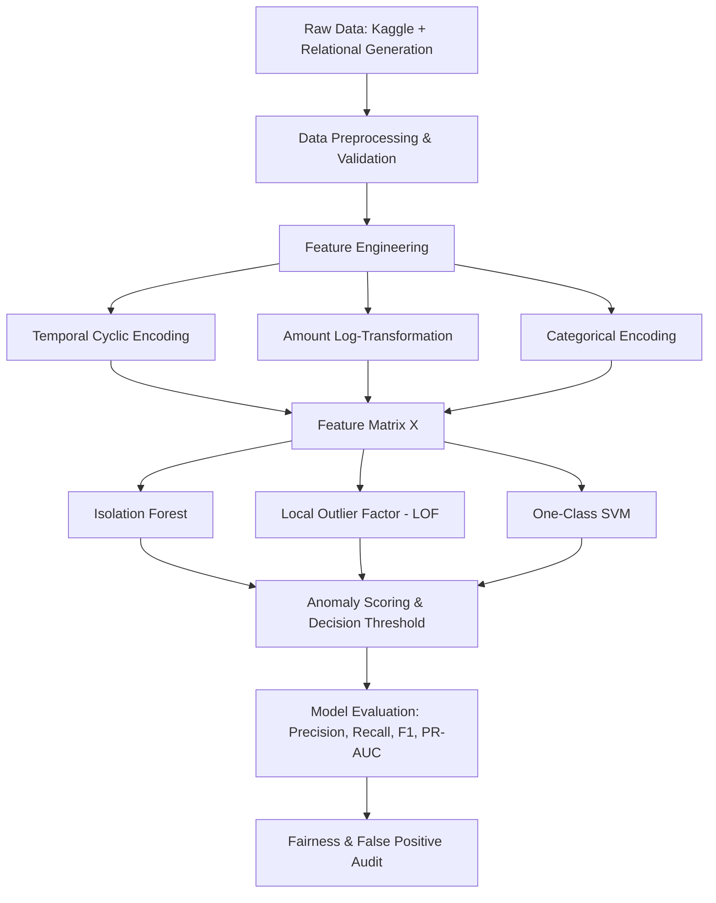

# Project Content & Technical Documentation

**Project Name:** Credit Card Fraud Detection Using Anomaly Detection  
**Domain:** Digital-Data-AI / AIML  
**Organization:** HCL AIML Project  
**Author:** AI/ML Engineering Team  
**Version:** 1.0  

---

## 1. Executive Summary

Financial fraud in digital payments represents an existential threat to modern banking infrastructure, causing billions of dollars in annual losses worldwide. Conventional rule-based detection systems (e.g., hard-coded spend limits, rigid geographic flags) suffer from high maintenance overhead, sluggish response to emerging fraud vectors, and high False Positive Rates (FPR).

This project addresses these challenges by implementing **Unsupervised & Semi-Supervised Anomaly Detection** algorithms on credit card transaction streams. Rather than relying solely on scarce historical fraud labels, our models construct a statistical profile of legitimate customer spending behavior and identify fraudulent transactions as low-density outliers or path-isolated anomalies.

---

## 2. Problem Statement & Motivation

### 2.1 The Imbalance Dilemma
In real-world credit card data (such as the Kaggle European Cardholder dataset), fraudulent activities account for only **0.17%** of all transactions (492 out of 284,807). This acute class imbalance causes standard supervised classifiers (e.g., Logistic Regression, naive Decision Trees) to achieve trivial 99.8% accuracy by simply predicting every transaction as legitimate, failing completely at fraud prevention.

### 2.2 The Cost Asymmetry of Errors
- **False Negative (Missed Fraud):** Results in direct financial loss, chargeback costs, and diminished merchant trust.
- **False Positive (False Alarm / Declining Valid Purchase):** Frustrates legitimate cardholders, causes embarrassment at the checkout counter, and leads to customer attrition ("card abandon").

An effective anomaly detection engine must optimize the trade-off by maintaining high **Precision** (minimizing false alarms) while achieving sufficient **Recall** (capturing fraudulent incursions).

---

## 3. Dataset Architecture & Data Dictionary

The project dataset ([`dataset.csv`](dataset.csv)) contains **5,000 transactions** with a calibrated anomaly rate of **3.50% (175 fraudulent rows)**. The data combines real-world statistical properties from the Kaggle dataset with relational transaction attributes.

### 3.1 Data Dictionary

| Column Name | Data Type | Constraint / Format | Description & Business Rules |
| :--- | :--- | :--- | :--- |
| `trans_id` | String | Unique, non-null (`TXN_XXXXX`) | Sequential primary key for transaction auditing. |
| `timestamp` | Datetime | Format: `YYYY-MM-DD HH:MM:SS` | Chronological transaction timestamp. Accounts for diurnal rhythms (day/night traffic density). |
| `card_token` | String | Masked PCI-compliant string | Tokenized card number preserving BIN/IIN prefix and 4-digit suffix while masking middle digits (e.g., `4864-XXXX-XXXX-8846`). |
| `amount` | Float | Positive real ($0.50 – $3,500.00) | Value of transaction in USD/currency. Rounded to 2 decimal places. |
| `merchant_category`| Categorical | 10 Predefined categories | Industry classification code: `grocery_supermarket`, `dining_restaurant`, `online_retail`, `gas_automotive`, `travel_airlines`, `electronics`, `health_pharmacy`, `entertainment_media`, `utilities_services`, `luxury_goods`. |
| `is_fraud` | Integer | Binary (`0` or `1`) | Ground truth label: `0` = Legitimate transaction, `1` = Fraudulent anomaly. |
| `merchant_id` | Categorical | Format: `MCH_<CAT>_XXX` | Unique identifier for registered merchant entities (176 distinct vendors). |
| `card_type` | Categorical | 5 Major Card Networks | Card issuer brand: `Visa` (44%), `MasterCard` (30%), `American Express` (13%), `Discover` (8%), `RuPay` (5%). |

---

## 4. Methodology & Theoretical Foundations

### 4.1 SMOTE Augmentation Rationale
The Synthetic Minority Over-sampling Technique (**SMOTE**) synthesizes novel fraud samples along the feature space segments connecting $k$-nearest neighbors:
$$\mathbf{x}_{\text{new}} = \mathbf{x}_i + \lambda (\mathbf{x}_{zi} - \mathbf{x}_i), \quad \lambda \sim U(0, 1)$$
This approach avoids exact sample duplication, preventing overfitting while realistically interpolating between historical fraud patterns (e.g., micro-testing authorizations followed by luxury/electronic ticket spending).

### 4.2 Anomaly Detection Algorithms

#### 1. Isolation Forest (iForest)
- **Principle:** Anomalies are "few and different". In a random tree partition, anomalies are isolated near the root with much shorter path lengths than normal cluster points.
- **Anomaly Score Formula:**
  $$s(x, n) = 2^{-\frac{E(h(x))}{c(n)}}$$
  where $h(x)$ is the path length of observation $x$, $E(h(x))$ is the average path length across an ensemble of isolation trees, and $c(n)$ is the average path length of unsuccessful searches in a Binary Search Tree (BST) of size $n$:
  $$c(n) = 2\left(\ln(n - 1) + 0.5772156649\right) - \frac{2(n - 1)}{n}$$
  - If $s \to 1$: Observation is flagged as a high-confidence anomaly.
  - If $s < 0.5$: Observation is considered normal.

#### 2. Local Outlier Factor (LOF)
- **Principle:** Measures the local density deviation of a transaction relative to its $k$-nearest neighbors. Transactions located in regions of substantially lower density than their surrounding neighborhood are flagged as outliers.

#### 3. One-Class Support Vector Machine (OC-SVM)
- **Principle:** Maps normal transaction vectors into a high-dimensional feature space using an RBF kernel and calculates the maximum margin hyperplane separating the normal distribution from the origin.

---

## 5. Feature Engineering Pipeline

1. **Temporal Encoding:**
   - Transactions exhibit strong circadian cycles. Direct linear hours (0 to 23) create an artificial discontinuity between 23:59 and 00:00.
   - We apply trigonometric encoding:
     $$\text{hour\_sin} = \sin\left(\frac{2\pi \cdot \text{hour}}{24}\right), \quad \text{hour\_cos} = \cos\left(\frac{2\pi \cdot \text{hour}}{24}\right)$$
2. **Amount Normalization:**
   - Transaction amounts follow a heavy right-skewed lognormal distribution.
   - Transformation applied:
     $$x_{\text{transformed}} = \ln(1 + \text{amount})$$
3. **Categorical Profiling:**
   - One-hot encoding for `merchant_category` and `card_type` to preserve non-ordinal distance metrics.

---

## 6. Evaluation Framework

Due to class imbalance, **standard accuracy is strictly disqualified**. The evaluation relies on:
- **Precision:** $\frac{TP}{TP + FP}$ (Proportion of flagged alerts that are genuine fraud).
- **Recall (Sensitivity):** $\frac{TP}{TP + FN}$ (Proportion of actual frauds caught).
- **F1-Score:** Harmonic mean balancing alert accuracy and breach coverage:
  $$F_1 = 2 \cdot \frac{\text{Precision} \cdot \text{Recall}}{\text{Precision} + \text{Recall}}$$
- **PR-AUC (Precision-Recall Area Under Curve):** The definitive benchmark for rare event anomaly detection.

---

## 7. Ethical AI & Fairness Guidelines

> **Mandatory Ethical Standard:** Fraud models directly dictate individuals' access to their financial capital. An uncalibrated model can unjustly decline cards belonging to specific cardholder segments, causing financial lockouts and socio-economic harm.

1. **Demographic Parity of False Positive Rates (FPR):**
   - The FPR across card brands (`RuPay`, `Visa`, `MasterCard`, `Amex`, `Discover`) must stay within a strict tolerance band ($\pm 1.5\%$) to prevent systemic disadvantage to any consumer group.
2. **Zero Sensitive Attributes in Feature Vector:**
   - Models must strictly exclude demographic, gender, age, or postal code proxies, relying exclusively on transactional behavioral characteristics.
3. **Contestable Alerts & Rapid Recovery:**
   - Financial access must never be permanently revoked solely based on an unsupervised model score. An automated step-up authentication (SMS/App OTP) must be offered before any hard card block is executed.
